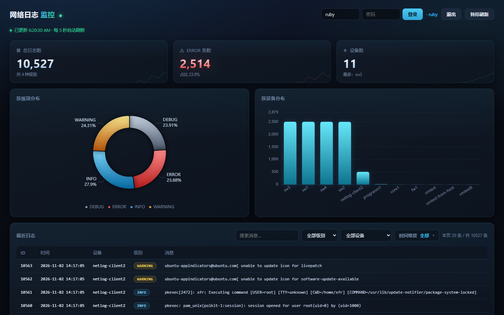

# netlog-service

接收网络设备 syslog 的轻量日志服务：UDP 收报文 → 解析入库 → 多条件查询 → 可视化。



## 它解决什么问题

网络里的交换机、路由器、Linux 主机都会往 syslog 服务器发日志，但原始 syslog 是一堆散落的 UDP 报文，
出故障时想「查一下昨天 sw1 的所有 ERROR」几乎做不到。

这个项目把 syslog 收下来结构化存进数据库，提供筛选查询、统计和实时看板。

## 技术栈

| 层 | 选型 |
|---|---|
| Web | FastAPI + Pydantic |
| 存储 | SQLite（单机、零运维） |
| 接收 | 原生 `socket`（UDP 1514） |
| 鉴权 | 自实现 JWT（标准库 `hmac` + `hashlib`）+ API Key |
| 前端 | 单文件 `index.html`，原生 JS + ECharts，无构建链 |
| 测试 | pytest + httpx（29 个用例） |

## 架构

```
                    ┌─────────────────────────────────────────┐
  交换机 / rsyslog  │  app/syslog/receiver.py   (UDP :1514)    │
  ──── syslog ─────▶│    parse()  →  message_id = sha256(报文) │
                    │    INSERT OR IGNORE  ← 幂等              │
                    └──────────────────┬──────────────────────┘
                                       │
   浏览器 ──HTTP──▶ ┌──────────────────▼──────────────────────┐
   设备   ──HTTP──▶ │  FastAPI                                 │
                    │    /auth/*    注册登录（JWT）            │
                    │    /logs      GET 查询(JWT) POST 上报(Key)│
                    │    /stats     统计（JWT）                 │
                    │    /          可视化页面                  │
                    └──────────────────┬──────────────────────┘
                                       │
                                  logs.db (SQLite)
```

## 快速开始

```bash
pip install -r requirements.txt
python seed.py                                 

export API_KEY="dev-key"                        
export JWT_SECRET="$(python -c 'import secrets;print(secrets.token_urlsafe(32))')"

uvicorn main:app --reload
```

注册用户 → 打开 <http://127.0.0.1:8000/> 登录：

```bash
curl -X POST localhost:8000/auth/register \
  -H 'Content-Type: application/json' \
  -d '{"username":"demo","password":"demo123456"}'
```

想让页面上的数字动起来：`python simulate.py --interval 1`（模拟设备持续上报）。
接真实设备见 [docs/device-setup.md](docs/device-setup.md)。

## 接口

| 方法 | 路径 | 说明 | 鉴权 |
|---|---|---|---|
| POST | `/auth/register` | 注册 | — |
| POST | `/auth/login` | 登录，返回 JWT | — |
| GET | `/logs` | 查询（筛选 + 分页 + 排序） | `Bearer <JWT>` |
| GET | `/stats` | 按级别 / 设备统计 | `Bearer <JWT>` |
| POST | `/logs` | 设备批量上报 | `X-Api-Key` |
| GET | `/health` | 健康检查 | — |

`/logs` 支持 `device` `level` `q` `since` `until` `n` `page` `order`，返回 `{"data": [...], "total": N}`。
`/stats` 接受同样的筛选参数，所以筛选时卡片和图表会一起变。

## 设计要点

### 1. 双鉴权：JWT 给用户，API Key 给设备

```
浏览器（人）  ──Authorization: Bearer <JWT>──▶  GET /logs、/stats
设备（机器）  ──X-Api-Key: <固定密钥>─────────▶  POST /logs
```

设备（交换机、rsyslog）不会登录，给它长期密钥最简单；浏览器侧有人操作，用 JWT 有时效、能识别身份。
两套并存比强行统一更贴合实际。


```
token = base64url(header) . base64url(payload) . base64url(HMAC-SHA256(key, "header.payload"))
```


### 2. 幂等：同一个报文只入库一次

设备会重试、rsyslog 会重连，同一份日志可能被投递多次。

- HTTP 上报：客户端带 `message_id`，`INSERT OR IGNORE` + 唯一索引拦截重复
- syslog：`message_id = "syslog:" + sha256(原始报文)`，天然去重

### 3. 筛选下推：筛选必须在数据库层

最早的实现是「后端返回最近 20 条 → 前端在这 20 条里过滤」，结果选 `sw1` 永远是空的
（最近 20 条全是另一台设备）。

改成筛选条件全部下推到 SQL，`total` 用同一套 `WHERE` 单独 `COUNT(*)`：

```sql
SELECT * FROM logs WHERE device = ? AND substr(ts,1,10) >= ? ORDER BY id DESC LIMIT ? OFFSET ?
SELECT COUNT(*) FROM logs WHERE device = ? AND substr(ts,1,10) >= ?
```

日期过滤用 `substr(ts, 1, 10)` 而不是 `date(ts)`：`YYYY-MM-DD` 的字符串字典序等价于时间序，
纯切片比解析成日期快。过滤条件抽成 `app/filters.py` 里的 `LogFilter` 依赖，`/logs` 和 `/stats` 共用。

### 4. 一个前端容易被忽略的坑

筛选器的**选项**不能跟着筛选结果收缩，否则用户想从 `sw4` 切到 `sw1` 时，
下拉里已经没有 `sw1` 了——必须先点「全部设备」才行。

所以 `refresh()` 发三个并行请求：**全量 `/stats` 只喂下拉选项**，筛选后的 `/stats` 喂卡片图表，
`/logs` 喂表格。重建下拉后还要把 `select.value` 恢复回去。


## 测试

```bash
pytest -q       # 29 passed
```

| 覆盖 | 内容 |
|---|---|
| 鉴权 | 无 token / 伪造 token / 缺 `Bearer` / 上报只带 JWT 被拒 |
| 参数边界 | `n=0`、`n=-1`、`n=abc`、`order=xxx` 都应 422 |
| 业务 | 排序方向、注册重复、密码错误、密码长度校验 |
| 解析 | RFC 3164 / 5424、异常报文、个位数日期 |

## 项目结构

```
app/
├── main.py            FastAPI 入口：挂载静态文件、注册路由、请求日志中间件
├── db.py              SQLite 连接（依赖注入）+ users 表初始化
├── models.py          Pydantic 模型
├── filters.py         LogFilter：/logs 和 /stats 共用的筛选条件
├── security.py        JWT 签发/校验 + PBKDF2 密码哈希（零依赖）
├── dependencies.py    verify_api_key / verify_token
├── routers/
│   ├── auth.py        注册、登录
│   ├── logs.py        查询、上报
│   └── stats.py       统计
└── syslog/
    ├── parser.py      RFC 3164 / 5424 解析
    └── receiver.py    UDP 接收器（独立进程）
static/
├── index.html         单文件前端
└── vendor/echarts.min.js
seed.py                一次性灌演示数据
simulate.py            持续上报模拟器
tests/                 pytest
```

## 已知限制


| 限制 | 说明 | 如果要改 |
|---|---|---|
| 单机 SQLite | 没有并发写优化，不适合高吞吐 | 换 PostgreSQL + 连接池 |
| JWT 不可撤销 | 签发后只能等过期（默认 1 小时） | 加 Redis 黑名单，或改短 TTL + refresh token |
| `/stats` 全表扫描 | 每次 `COUNT(*)`，几十万行后会慢 | `level` / `device` / `ts` 建索引，或缓存 30 秒 |
| 无分页 UI | 页面只显示最近 20 条 | 加「加载更多」或页码 |
| 密码策略宽松 | 只校验长度 ≥ 6 | 加复杂度要求、登录失败锁定 |
| 无 HTTPS | 本地演示用 HTTP | 生产放 Nginx / Caddy 后面 |

## 仓库

<https://github.com/Rubyxce/netlog-service>
